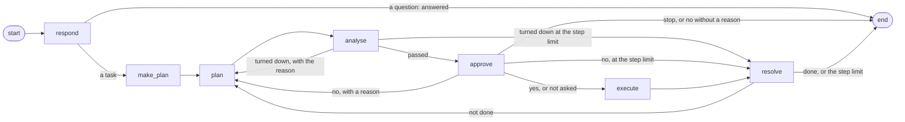

# The agent's graph

Every route in `graph.py` and the nodes' own routing (`nodes.py`: each node's
`Command[Literal[...]]`). Mermaid; paste into any Mermaid renderer for the report.

- **respond**: the front desk; a task, or a question it answers itself.
- **make_plan**: the task's plan, a few plain steps, once per task (skipped for the glasses' price lookups).
- **plan**: picks the next action from the page.
- **analyse**: the checks in code, then the verifier model (versions with `VERIFIER=on`).
- **approve**: asks the user, if the approval setting calls for it.
- **execute**: does the action in the browser.
- **resolve**: finishes the task or goes back to plan.

When a node fails after its retries, the error handler (`graph.default_error_handler`)
ends the task with a plain message, except a failed `execute`, which goes back to
plan once.
